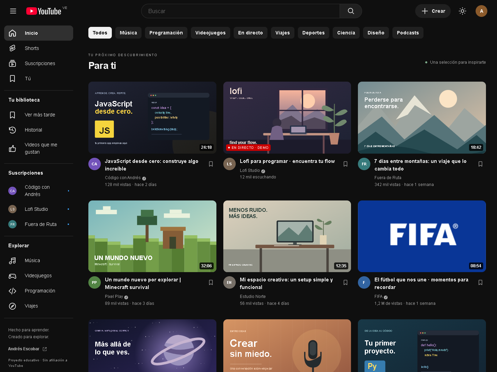
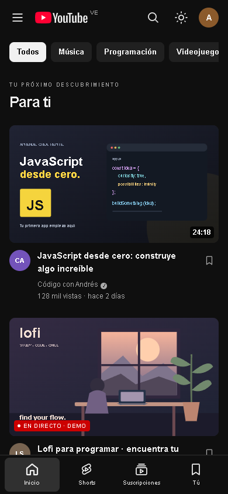

# YouTube · Copia de Andrés

Una demo educativa de la interfaz de YouTube, hecha con **HTML, CSS y JavaScript**, sin frameworks ni dependencias de ejecución. El foco está en el diseño adaptable, la accesibilidad y las interacciones del catálogo.

[Ver sitio en GitHub Pages](https://andresescobar14.github.io/Copia-YouTube-Andres/) · [Repositorio](https://github.com/andresescobar14/Copia-YouTube-Andres)



## Qué puedes hacer

- Buscar por título, canal, categoría o etiquetas, ignorando mayúsculas y acentos.
- Combinar la búsqueda con los filtros de categorías.
- Explorar Inicio, Shorts, suscripciones y canales individuales.
- Abrir una vista previa y buscar contenido relacionado en YouTube.
- Guardar tarjetas para ver más tarde, marcar favoritos y consultar el historial.
- Suscribirte a los canales de demostración.
- Crear hasta 100 tarjetas propias mediante el botón **Crear**; en móvil está en el menú.
- Cambiar entre tema claro y oscuro.

La biblioteca, las tarjetas propias y el tema se conservan en `localStorage`. Si el navegador bloquea el almacenamiento, la demo sigue funcionando durante la sesión y muestra un aviso.

> Es una copia de interfaz con datos de ejemplo, no un servicio de streaming. Las estadísticas, los canales destacados y el estado de directo son ilustrativos. No se suben videos, no hay cuentas reales y no se usa la API de YouTube. El enlace de cada vista previa abre una búsqueda en YouTube.

## Ejecutar en tu equipo

Puedes abrir `index.html` directamente en un navegador moderno. Para tener un origen local estable y que el almacenamiento funcione de forma consistente, usa **Node.js 22 o superior**:

```sh
git clone https://github.com/andresescobar14/Copia-YouTube-Andres.git
cd Copia-YouTube-Andres
npm start
```

Abre [localhost:3000](http://localhost:3000). No hace falta ejecutar `npm install`: los comandos utilizan módulos integrados de Node.js.

Para usar otro puerto, establece la variable de entorno `PORT` antes de ejecutar `npm start`. El servidor de desarrollo solo escucha en tu equipo.

## Diseño adaptable y accesibilidad

| Ancho de pantalla | Distribución |
| --- | --- |
| Hasta 540 px | Una columna y navegación inferior |
| 541–760 px | Dos columnas, menú desplegable y navegación inferior |
| 761–1199 px | Dos columnas y barra lateral compacta |
| 1200–1799 px | Tres columnas y barra lateral completa |
| Desde 1800 px | Cuatro columnas |

Las categorías se desplazan horizontalmente sin provocar desbordamiento de la página. Las miniaturas mantienen una proporción 16:9, y los títulos largos se limitan a dos líneas.

La interfaz incluye etiquetas para botones e inputs, enlace para saltar al contenido, foco visible, estados `aria-pressed` y `aria-current`, anuncios de resultados y diálogos nativos con control de foco. Respeta la preferencia de movimiento reducido.

- **Tab / Shift + Tab**: recorrer controles.
- **Enter / Espacio**: activar botones.
- **/**: enfocar la búsqueda cuando no estás escribiendo.
- **Escape**: cerrar diálogos o la búsqueda móvil.

<details>
<summary>Ver la versión móvil</summary>



</details>

## Organización del código

```text
.
├── index.html                 # Estructura semántica, iconos y diálogos
├── style.css                  # Temas, componentes y puntos de adaptación
├── catalog.js                 # Datos, filtros y validación del almacenamiento
├── app.js                     # Renderizado e interacciones
├── images/
│   ├── thumbnails/            # Ilustraciones SVG locales
│   ├── youtube.svg            # Logotipo para tema oscuro
│   └── youtube-light.svg      # Logotipo para tema claro
├── docs/                      # Capturas de escritorio y móvil
├── scripts/
│   ├── serve.js               # Servidor local sin dependencias
│   └── build.js               # Prepara los archivos públicos en dist/
├── tests/catalog.test.js      # Pruebas de búsqueda, biblioteca y datos
└── .github/workflows/pages.yml
```

### Personalizar

Edita `videos` en `catalog.js` para añadir o modificar contenido. Cada tarjeta tiene un identificador único, título, canal, categoría, miniatura local y duración. Las etiquetas amplían las búsquedas; `short: true` la incluye en Shorts y `live: true` en el filtro de directo.

Los colores, tamaños de la cabecera y ancho de la barra lateral están en las variables de `:root` en `style.css`. Los temas comparten las mismas reglas de componentes. Los textos de tarjetas creadas por el usuario se escapan antes de insertarse en el HTML; sus rutas de imagen se seleccionan del catálogo local.

## Validar y preparar la publicación

```sh
npm run check
npm run build
```

`check` comprueba la sintaxis de JavaScript y ejecuta seis pruebas de búsqueda, filtros combinados, biblioteca, almacenamiento dañado, tarjetas propias y existencia de miniaturas. `build` copia únicamente el sitio y sus recursos a `dist/`, incluyendo `.nojekyll`.

La interfaz también se verificó en Chrome a **320, 375, 390, 540, 600, 760, 768, 1024, 1200, 1440 y 1920 px**: sin desbordamiento horizontal, recursos faltantes ni errores de JavaScript. Se comprobaron búsqueda, filtros, biblioteca, persistencia, temas, creación de tarjetas, menú móvil, apertura directa del archivo y almacenamiento bloqueado.

## GitHub Pages

El flujo `pages.yml` valida el proyecto en cada cambio y pull request a `main`. Los cambios de `main` publican automáticamente el contenido de `dist/` en GitHub Pages; los pull requests solo validan.

Para habilitarlo por primera vez:

1. En el repositorio, abre **Settings → Pages**.
2. En **Build and deployment → Source**, selecciona **GitHub Actions**.
3. Envía los cambios a `main` o ejecuta manualmente **Validate and deploy GitHub Pages** desde **Actions**.
4. Comprueba que los trabajos `build` y `deploy` terminen correctamente.

Las rutas de recursos son relativas y funcionan bajo `/Copia-YouTube-Andres/`. El flujo sigue las [instrucciones oficiales de GitHub Pages](https://docs.github.com/en/pages/getting-started-with-github-pages/using-custom-workflows-with-github-pages).

## Recursos y autoría

Las miniaturas SVG se crearon para esta demo y se sirven localmente. Se conserva la imagen de FIFA que ya incluía el repositorio. La carga inicial no necesita fuentes, bibliotecas, avatares ni imágenes de terceros.

**Autor: Andrés Escobar.** YouTube y FIFA son marcas de sus respectivos propietarios. Este proyecto es educativo y no está afiliado a ellas.
